# FPGA-Accelerated Trading System: A Plain-Language Project Overview

My project replays real, historical Nasdaq stock market data into a $30 FPGA board that rebuilds the order book, calculates a few simple signals, runs a tiny model, and outputs buy, sell or hold. It also counts exactly how many clock cycles each decision takes. It will not make money, and it doesn't need to. What it proves is that I can build and verify the same kind of hardware pipeline that firms like Citadel Securities, Hudson River Trading and DRW run in production.

## TL;DR

- **What the project is:** a "tick-to-decision" pipeline in hardware. Recorded Nasdaq ITCH 5.0 messages (Nasdaq publishes sample files for free) are loaded onto a Sipeed Tang Nano 20K board. The board then plays them back at full clock speed through a parser, an order book, a feature calculator and a small model, and the latency is counted in clock cycles. Real firms do the same thing in as little as 13.9 nanoseconds on $10,000+ cards. That figure is the June 2024 STAC-T0 record set by Exegy on an AMD Alveo UL3524, which beat the previous record of 24.2 ns. A realistic goal for me is a few hundred nanoseconds.
- **What the model does:** it guesses whether the mid-price will tick up or down in the next moment, using features like order book imbalance and microprice. These ideas come straight from public research (Cont, Kukanov and Stoikov 2014; Stoikov 2018). Deep models like DeepLOB score well on the FI-2010 benchmark, but the 2024 LOBCAST benchmark of 15 such models (Prata et al.) found that "all models exhibit a significant performance drop when exposed to new data", with F1 scores falling to 48 to 61% on Nasdaq stock data. So a small, honest linear or quantized model is the right choice for me, not a compromise.
- **Why it matters for my career:** the skills here (Verilog, cycle-accurate verification with cocotb, timing closure, binary protocol parsing) are the core of HFT FPGA roles and of semiconductor RTL and verification roles. In Canada, Citadel Securities has a Toronto office, DRW posts FPGA roles in Montreal, and AMD, Qualcomm, Marvell, Tenstorrent, Altera and NVIDIA all hire RTL and verification people in the GTA.

## Key Findings

1. **The data is real and free.** Nasdaq hosts sample TotalView-ITCH 5.0 files for anyone to download. Full Nasdaq days are big: Nasdaq says version 5.0 files "average 5-10 GB compressed and 15-25GB uncompressed". I should start with a smaller Nasdaq BX or PSX file and filter it down to one stock.\[1\]\[2\]
2. **Speed is the whole reason FPGAs exist in trading.** In April 2024, AMD and Exegy set a STAC-T0 benchmark record of 13.9 nanoseconds tick-to-trade on an AMD Alveo UL3524 card. AMD told WatersTechnology that data entering and exiting its FPGA fabric takes "a mere three nanoseconds", with another 10 to 20 nanoseconds inside the fabric, while "a software-based approach running on a CPU could entail microseconds". That is hundreds of times slower.
3. **My board is tiny but sufficient.** The Tang Nano 20K has 20,736 LUTs, 15,552 flip-flops, 828K bits of block RAM, 64 Mbit of SDRAM and 48 hardware multipliers. The Alveo UL3524 has 780K LUTs and 1,680 DSP slices.\[3\]\[4\] That is roughly 38 times more logic, but the architecture ideas carry over.
4. **Simple signals are the honest starting point.** Cont, Kukanov and Stoikov found that over short intervals, price changes are "mainly driven by the order flow imbalance". But they measured imbalance and price change over the *same* window, so it explains price moves more than it predicts them.\[5\]\[6\] Any prediction my model makes will be weaker than that headline result.
5. **ASICs are the next frontier, but only for the biggest firms.** Reporting in 2025 described Hudson River Trading hiring veteran chip designers from D. E. Shaw as it deepens "its investment in ASIC-based infrastructure".\[7\] For a student, the realistic upgrade path is a bigger FPGA with Ethernet, not custom silicon.

---

## 1. What Trading Is and How Electronic Markets Work

### The basic idea

A stock is a tiny slice of ownership in a company. People want to buy and sell those slices, and an **exchange** (like Nasdaq) is the marketplace where they meet. Today that marketplace is a set of computers in a data centre. For Nasdaq, that data centre is in Carteret, New Jersey.\[8\]

### Orders, bids and asks

Nobody shouts prices anymore. Instead, people send **orders**:

- A **bid** is an offer to buy: "I'll buy 100 shares at $50.00."
- An **ask** (or offer) is an offer to sell: "I'll sell 100 shares at $50.02."
- The **best bid** is the highest price anyone is currently willing to pay. The **best ask** is the lowest price anyone is willing to sell at.
- The **spread** is the gap between them. In this example it is $0.02.
- The **mid-price** is halfway between them, so $50.01. My model tries to predict this number's next move.

There are two main kinds of order. A **limit order** says "buy at $50.00 or better, and wait if nobody is selling that low." A **market order** says "buy right now at whatever the best available price is."

### The limit order book

All the limit orders that are waiting form the **limit order book**. Picture two stacks of sticky notes. One stack holds buy notes sorted from highest price down, and the other holds sell notes sorted from lowest price up. The top note on each stack is the best bid and the best ask.

```
        SELL SIDE (asks)
   $50.04   300 shares
   $50.03   500 shares
   $50.02   200 shares   <- best ask
   ---------------------  spread = $0.02, mid = $50.01
   $50.00   400 shares   <- best bid
   $49.99   900 shares
   $49.98   100 shares
        BUY SIDE (bids)
```

### The matching engine

The exchange's **matching engine** is the program that runs the book. When a market order to buy 200 shares arrives, it matches against the best ask (200 at $50.02), and a trade happens. When orders sit at the same price, the one that arrived first usually gets filled first. This rule is called "price-time priority", and it is a big reason speed matters: being first in line at a price is valuable.

### Market makers and HFT

A **market maker** is a firm that always posts both a bid and an ask, like a currency exchange booth at the airport. It earns the small spread over and over, and it takes the risk of holding stock nobody else wants at that moment. **High-frequency trading (HFT)** firms are automated traders, many of them market makers, that react to market changes in microseconds or nanoseconds.

### Why speed matters

Imagine I'm a market maker quoting $50.00 / $50.02, and suddenly lots of buyers show up. If I don't update my ask fast enough, faster traders buy from me at $50.02 just before the price jumps to $50.05. I get "picked off". Speed is mostly about **not being the slow one with stale prices**, and about getting to the front of the queue. That is the economic reason a nanosecond-level hardware pipeline is worth building.

### Market microstructure in one paragraph

**Market microstructure** is the study of how these mechanics (order types, queues, spreads, who trades with whom) shape prices over very short timescales. My project lives entirely in this world. I'm not predicting whether Apple will be worth more next year. I'm predicting whether the next tick of the mid-price goes up or down, based only on what's visible in the order book right now.

---

## 2. How Market Data Is Received

### In the real world

Every time anything happens in the order book (a new order, a cancel, a trade), the exchange broadcasts a message describing it. Nasdaq's full-detail feed is **TotalView-ITCH 5.0**.\[9\]

Some key facts about ITCH, taken from Nasdaq's specification:

- **It's binary, not text.** All integer fields are big-endian (network byte order), so a computer has to decode raw bytes at fixed positions.\[9\]
- **Each message has a one-letter type.** "A" means Add Order, "X" means Order Cancel, "E" means Order Executed, "P" means Trade, and so on.\[10\]
- **Timestamps are in nanoseconds since midnight.**\[11\]
- **Prices are integers with 4 implied decimal places**, so 501000 means $50.1000. That is great for hardware, because there's no floating point.\[12\]
- **An Add Order message has fixed fields:** type at byte 0, stock locate at byte 1, tracking number at byte 3, a 6-byte timestamp at byte 5, an 8-byte order reference number at byte 11, then buy/sell side, shares, stock symbol and price.\[13\]

**How it travels:** Nasdaq delivers ITCH using **MoldUDP64** over **UDP multicast**, or over **SoupBinTCP**.\[14\] Multicast is like a radio broadcast. The exchange sends each packet once and every subscriber receives it, but nothing gets resent automatically.\[15\] MoldUDP64 adds sequence numbers so a receiver can spot a missed packet and ask for it again through a separate channel.\[16\]\[17\]

**Direct feeds vs consolidated feeds:** Each US exchange sells its own **direct feed**. There is also a public **consolidated feed** called the SIP (Securities Information Processor), which merges the best prices from all exchanges. Merging takes time.\[18\]\[19\] In a filing to the SEC, NYSE reported median SIP quote processing latency of 70 microseconds for Tape A and B stocks and 17 microseconds for Tape C.\[20\] That sounds tiny, but it's an eternity next to a 14-nanosecond FPGA. That's why HFT firms pay for direct feeds.

**Co-location:** Firms rent rack space inside the exchange's own data centre, so the cable from the matching engine to their server is a few metres long.\[21\] Between cities, they go further. The Chicago to New Jersey route has a theoretical speed-of-light limit of about 3.93 milliseconds one way.\[22\] A 2020 study by Bhattacherjee et al. (ACM IMC '20) found the fastest licensed microwave network on that path, New Line Networks, at 3.96171 milliseconds from the CME to the NY4 data centre, very close to physics' limit. Fiber is slower, because light in glass travels at roughly two-thirds of its speed in air and cables can't run in perfectly straight lines.\[23\]\[24\]

### In my project

I'm not co-located anywhere, and I don't need to be. Here's the plan:

1. **Download** a sample ITCH file from Nasdaq's public sample site (emi.nasdaq.com/ITCH). I'll start with a small BX or PSX day, not the multi-gigabyte main Nasdaq file.\[2\]
2. **Filter** it on my PC with Python to one stock and a manageable slice, for example a few hundred thousand messages.
3. **Load** that slice over the board's USB-UART link into the on-board SDRAM, which holds 64 Mbit (8 MB).\[4\] UART is slow. At 3 Mbaud with 8N1 framing it moves about 300 KB per second, so a 4 MB slice takes around 13 seconds.\[25\] That's fine, because loading isn't the part I'm timing.
4. **Replay** the buffered messages from SDRAM or block RAM into the pipeline at the full clock rate.
5. **Measure** cycles from "first byte of message enters the parser" to "decision comes out", and send the results back over UART.

**Why buffer-and-replay matters:** if I streamed data straight from UART into the pipeline, the pipeline would spend almost all of its time waiting for the next byte. My "latency" number would really be measuring how slow the cable is. Buffering first means the measurement reflects my logic, not the cable. Real firms also test this way: they record ("capture") live feeds and replay them through their hardware.

---

## 3. End-to-End Flow of the Project

### The big picture

```mermaid
flowchart LR
    A[Nasdaq ITCH sample file] --> B[PC: Python filter + golden model]
    B -->|UART load| C[On-board SDRAM / BRAM buffer]
    C -->|replay at full clock| D[ITCH parser]
    D --> E[Order book: best bid/ask]
    E --> F[Features: imbalance, microprice, spread]
    F --> G[Tiny model: linear or quantized NN]
    G --> H[Decision: BUY / SELL / HOLD]
    H --> I[Cycle counter + UART out]
    I --> J[PC: backtest + compare vs golden model]
```



The same thing as plain text:

```
[ITCH file] -> [PC filter] --UART--> [SDRAM buffer]
                                         |
                              (replay at full speed)
                                         v
 [Parser] -> [Order Book] -> [Features] -> [Model] -> [Decision]
    |____________________ cycle counter __________________|
                                         |
                                       UART
                                         v
                       [PC: simulated P&L, check vs Python]
```

### Each stage in plain language

| Stage | What it does | Analogy | Where it runs |
|---|---|---|---|
| **Parser** | Reads raw bytes, figures out the message type and pulls out fields like price, shares and order ID | A mail sorter reading envelope labels | FPGA |
| **Order book** | Keeps track of every live order and the current best bid and best ask | The two stacks of sticky notes | FPGA (block RAM) |
| **Features** | Turns the book into a few numbers: imbalance, microprice, spread | A doctor taking pulse and blood pressure | FPGA |
| **Model** | Combines features with learned weights to score "up" vs "down" | A weighted checklist | FPGA (multipliers) |
| **Decision** | Turns the score into BUY, SELL or HOLD using thresholds | A thermostat switching on or off | FPGA |
| **Latency counter** | Counts clock ticks from input to decision | A stopwatch | FPGA |
| **Backtest** | Pretends to trade on the decisions and adds up profit and loss | A flight simulator | PC (Python) |

### The golden model: my safety net

Before writing any Verilog, I build the *whole* pipeline in Python: parser, book, features and model. This is the **golden reference model**. Then I use **Verilator** (which turns Verilog into a fast C++ simulation) and **cocotb** (which lets me write hardware tests in Python) to feed identical messages into both versions and check that they match exactly, message by message and cycle by cycle. Professional shops work this way too. Hudson River Trading has written publicly that it prefers verifying its SystemVerilog designs with C++ and Python, partly so it can reuse code it already trusts.\[26\]

---

## 4. What the Model Outputs and How It's Used

### The output

At every order book update, the model produces a score, either one number or three (up, flat, down). A threshold turns it into an action:

- Score strongly positive: **BUY** (I expect the mid-price to rise)
- Score strongly negative: **SELL**
- In between: **HOLD** (not confident enough to act)

### Turning signals into simulated trades

On the PC, a **backtest** replays history and pretends to act on each decision. It tracks:

- **Position:** how many shares I hold, with a cap so I can't buy without limit
- **P&L (profit and loss):** what I made or lost
- **Hit rate:** how often the direction call was right

### Transaction costs: the part that kills most strategies

Here's the catch. If I buy with a market order, I pay the ask. If I sell straight away, I receive the bid. That means **I lose the spread on every round trip** before any fees. A model can be right 55% of the time and still lose money if each move it catches is smaller than the spread. My backtest has to charge the spread plus a small fee per trade. Otherwise the results are fiction.

### Why my model won't be profitable, and why that's okay

- **I'm not first in line.** Real firms profit partly by having orders queued at the front. My replayed data can't simulate where my own order would sit in the queue, or how other traders would react to it.
- **The signals are public.** Order book imbalance is so well known that Pulido, Rosenbaum and Sfendourakis titled a 2023 paper (published in *Finance and Stochastics* in 2026) "Understanding the worst-kept secret of high-frequency trading", a phrase they credit to Sasha Stoikov. Whatever edge it gives has been competed down to almost nothing.
- **Historical replay ignores my impact.** In real life, my orders change the book. In a replay they don't.

None of that undermines the project. Its real product is a **verified, cycle-accurate, low-latency hardware pipeline with an honest latency number**. Hiring managers for FPGA roles care whether my parser is correct under every message type, not whether my toy model beats the market.

---

## 5. Training the Model

This part should feel familiar after MNIST. The workflow is the same; only the data changes.

### Step 1: Build the dataset from the Python order book

My Python golden model replays the ITCH file and, at every book update, records a snapshot of features. That gives me rows of numbers, like MNIST pixel arrays but much smaller.

### Step 2: Features (the inputs)

| Feature | Plain-language meaning | Formula idea |
|---|---|---|
| **Order book imbalance** | Are there more shares waiting to buy or to sell at the top of the book? | (bid size - ask size) / (bid size + ask size), between -1 and +1 |
| **Microprice** | A "fair price" that leans toward the side with fewer shares, since that side is more likely to get eaten through | Simplest version: weighted mid = ask x I + bid x (1 - I), where I = bid size / (bid size + ask size) |
| **Spread** | How wide the gap is | ask - bid |
| **Order flow imbalance (OFI)** | Net pressure from recent adds, cancels and trades at the best prices | Running sum of signed size changes at the best bid and best ask |
| **Recent trades** | Were the last few trades buyer-initiated or seller-initiated? | Count or sum of signed trade sizes |

Stoikov's 2018 paper "The micro-price: a high-frequency estimator of future prices" (in *Quantitative Finance*) argues that a properly estimated microprice predicts short-term prices better than either the plain mid-price or the simple weighted mid.\[27\]\[28\] The weighted mid in the table is the cheap, hardware-friendly approximation. Stoikov's full version needs lookup tables learned from data, and that could be a fun later upgrade.\[29\]

### Step 3: Labels (the "right answers")

For each snapshot, I look **forward** in time: did the mid-price go up, down, or stay the same over the next *k* events (say 10, 50 or 100 book updates)? That gives each row a label, much like MNIST gives each image a digit.

### Step 4: Split by time, never at random

This is the biggest difference from MNIST. With images, shuffling is fine. With markets, **shuffling leaks the future into training**. If I train on 2:00 pm and test on 1:59 pm, the model has effectively seen the answer.

The rules:

- **Train** on the earliest chunk (for example 9:30 am to 1:00 pm)
- **Validate** on the next chunk (1:00 to 2:30 pm) for tuning
- **Test** on the last chunk (2:30 to 4:00 pm), and only once
- Better still, train on one day and test on a *different* day

### Pitfalls to avoid

- **Look-ahead bias:** using any information at time *t* that wasn't actually known at time *t*. A common bug is calculating a feature with data from a few messages ahead.
- **Overfitting:** tuning until the backtest looks great on one day. Real-world results always look worse.
- **Class imbalance:** most of the time the mid-price doesn't move, so a model that always says "flat" scores high accuracy while being useless. The FI-2010 dataset is unbalanced in exactly this way, which is why DeepLOB's authors report F1 score rather than accuracy.\[30\] I should do the same.

### Step 5: Quantize for hardware

My PyTorch model uses 32-bit floating point. My FPGA has no floating-point unit, but it has 48 hardware multipliers that handle 18-bit by 18-bit integers.\[31\] So I convert the weights to **fixed-point integers** (for example 8-bit), scale them, and check how much accuracy drops. PyTorch has quantization tools for this, or I can simply round the weights myself and re-test in Python. The Python version using the exact same integer maths becomes the golden model for the hardware.

### Why HFT models are small

Every layer adds clock cycles, and every multiplication uses up multipliers. The researchers behind hls4ml (a tool that converts neural networks into FPGA logic) describe a nanosecond-latency regime where models have roughly O(100) to O(1000) parameters and need extensive pruning and quantization.\[32\] A model with ten features and a single linear layer, or one small hidden layer, fits that regime comfortably. In one hls4ml paper, a fully connected network for particle physics ran in about 75 to 150 nanoseconds at 200 MHz.\[33\]

### Can I adopt public strategies and improve on them?

Yes. This is the smart way to do it. An honest look at the main options:

| Public idea | What it is | Realistic for me? |
|---|---|---|
| **Order book imbalance / OFI** (Cont, Kukanov and Stoikov 2014, *Journal of Financial Econometrics*) | Using 50 US stocks, they showed a linear link between order flow imbalance and short-term price changes, with a slope inversely proportional to market depth\[5\] | **Yes, start here.** Cheap in hardware. Remember that it is mostly contemporaneous, not predictive |
| **Microprice** (Stoikov 2018) | A smarter "fair price" than the mid | **Yes.** Weighted-mid version now, lookup-table version later |
| **Avellaneda-Stoikov market making** (2008, *Quantitative Finance*) | A classic formula for where a market maker should place its bid and ask, shifting quotes based on current inventory and risk aversion\[34\] | **Partly.** Good to implement in the Python backtest. Hard to test honestly on replayed data, because I can't know whether my quotes would have been filled |
| **DeepLOB** (Zhang, Zohren and Roberts, *IEEE Transactions on Signal Processing*, 2019) | A CNN with an Inception module and an LSTM, trained on raw order book levels. About 60,000 parameters and a reported 0.253 ms forward pass\[35\]\[36\] | **As a reference, not on my board.** 60k parameters is far too many for nanosecond inference on a 20K-LUT FPGA. I could train it in PyTorch as a comparison baseline |
| **FI-2010 dataset** | The first public benchmark of limit order book data: five Finnish stocks (Kesko, Outokumpu, Sampo, Rautaruukki and Wärtsilä) from Nasdaq Nordic, covering 1 to 14 June 2010 (about 4 million messages), downsampled and pre-normalised. At the shortest horizon, 63% of labels are "stationary" | **Useful for practice**, but the DeepLOB authors themselves call it limited, since it comes from a less liquid market in 2010 |
| **LOBCAST** (Prata et al., *Artificial Intelligence Review*, 2024) | An open-source framework that benchmarked 15 deep learning order book models\[37\] | **Read it for honesty.** It found that "all models exhibit a significant performance drop when exposed to new data". The top model, BINCTABL, scored 82.6% F1 on FI-2010 but dropped by about 19.6% on average elsewhere |

**My recommended path:** (1) Implement imbalance and weighted microprice in Python. (2) Fit a logistic regression on those features. (3) Train a tiny one-hidden-layer network and see if it beats the linear model on a held-out *day*. (4) Quantize the winner. (5) Optionally train DeepLOB in PyTorch as an "upper bound" to see how much accuracy the tiny model gives up. That comparison is itself an interesting result to write up.

---

## 6. How the FPGA Ties In

### What an FPGA is, in plain language

A normal processor (CPU) is like a very fast chef who follows a recipe one step at a time. An **FPGA (Field-Programmable Gate Array)** is more like a box of tens of thousands of LEGO bricks: tiny logic blocks, memory blocks and multipliers that I wire together into a custom machine. Once wired, the machine doesn't "run a program". It *is* the program, and every part works at the same time.

I describe the wiring in a **hardware description language** (Verilog). Then tools turn it into a configuration file, called a **bitstream**, and load it onto the chip. On the Tang Nano 20K I can do all of that with fully open-source tools:

- **Yosys** for synthesis (Verilog to logic gates)
- **nextpnr** for place and route (deciding where each gate sits on the chip)
- **Apicula** to produce the Gowin bitstream
- **openFPGALoader** to flash the board\[25\]

### Why trading firms use FPGAs

1. **Deterministic latency.** A CPU might answer in 2 microseconds one time and 20 the next, because of the operating system, caches and interrupts. A pipeline in an FPGA takes the same number of clock cycles every single time.
2. **Parallelism.** While the parser decodes message 101, the book can update for message 100 and the model can score message 99, all in the same clock tick. That's **pipelining**, like an assembly line.
3. **Processing data "on the wire".** An FPGA can start decoding a packet before the whole packet has even arrived. In AMD's description, data entering and leaving the FPGA fabric takes about 3 nanoseconds, with another 10 to 20 nanoseconds spent inside the fabric.\[38\]
4. **Cheaper and quicker than custom chips.** Hudson River Trading puts it this way: FPGAs "allow the user to create custom hardware without many of the costs and delays associated with building custom chips."\[26\]

### What goes on the FPGA vs the CPU at real firms

| On the FPGA (the "fast path") | On the CPU / servers (the "slow path") |
|---|---|
| Network receive (Ethernet, UDP, MoldUDP64) | Research, model training, backtesting |
| ITCH parsing | Choosing which strategies run and setting their parameters |
| Order book for the symbols being traded | Complex models too big for hardware |
| Simple trigger logic: "if X happens, send order Y" | Monitoring, logging, compliance reporting |
| Pre-trade risk checks (position limits, price sanity) | Updating the FPGA's thresholds and weights between events |
| Building and sending the order (for example Nasdaq's OUCH protocol) | Anything that can afford microseconds or milliseconds |

A common pattern: the CPU does the "thinking" ahead of time and loads parameters into the FPGA, such as "if the imbalance crosses 0.7, send this order". The FPGA then does the "reacting" in nanoseconds. AMD's own UL3524 product brief lists pre-trade risk checking for SEC Rule 15c3-5 compliance as a main use, next to algorithmic trading.\[39\]

### How my project maps onto that

My parser, book, features, model and decision stages are a miniature version of the "fast path" column. The pieces I'm leaving out are the network front end (Ethernet), the order-sending back end and the risk checks. Those are natural upgrades later on.

---

## 7. The Tradeoffs I'm Making

### FPGA vs CPU vs GPU

| | CPU | GPU | FPGA |
|---|---|---|---|
| **Good at** | Flexible logic, anything | Huge batches of parallel maths | One stream of data, processed with fixed, tiny latency |
| **Typical trading latency** | Microseconds (software) | Not used for tick-to-trade; batching adds delay | Tens of nanoseconds (state of the art 13.9 ns, the 2024 STAC-T0 record) |
| **Ease of development** | Easiest | Medium | Hardest |
| **Where it fits in trading** | Strategy logic, slower trading | Training models, research | Ultra-low-latency fast path |

### Other key tradeoffs

- **Speed vs model complexity.** Every extra layer means more clock cycles and more multipliers. I'm deliberately choosing a tiny model so that the hardware story stays clean.
- **Precision vs accuracy.** Going from 32-bit float to 8-bit integers makes the model smaller and faster, but slightly less accurate. I'll measure exactly how much in Python.
- **Development effort.** A software parser takes a weekend. A verified hardware parser takes weeks. Hardware bugs are also harder to find, because many things happen at the same time.\[26\] That's why I verify in simulation first.
- **Hobby board vs industry hardware:**

| | Sipeed Tang Nano 20K | AMD Alveo UL3524 |
|---|---|---|
| Chip | Gowin GW2AR-18 | AMD Virtex UltraScale+ VU2P (custom 16nm part) |
| Logic | 20,736 LUTs | 780K LUTs |
| Multipliers / DSP | 48 (18x18) | 1,680 DSP slices |
| Networking | None (USB-UART only) | 64 ultra-low-latency transceivers, under 3 ns transceiver latency |
| Price | About US$25 to 30 for the bare board | Enterprise pricing (thousands of dollars) |
| Tools | Open source (Yosys, nextpnr, Apicula) | AMD Vivado |

Intel's FPGA business, now spun out as **Altera**, is the other major industry vendor. Altera has a Toronto engineering presence.\[40\]\[41\]

- **Clock speed.** A Hackaday review in September 2026 said the Tang Nano 20K is "quite comfortable in the low hundreds of MHz for appropriately pipelined designs."\[42\] I'll plan for something more modest, like 50 to 100 MHz. At 50 MHz each clock tick is 20 ns, so a 25-cycle pipeline means 500 ns of tick-to-decision latency. At 100 MHz that drops to 250 ns. The true number comes from the timing report produced by nextpnr.
- **UART vs Ethernet.** UART is simple and comes on the board, but it's far too slow for live data. I get around that with buffer-and-replay. Ethernet would let me receive real UDP packets, but it adds a lot of complexity (MAC, IP and UDP layers).
- **Simulation vs hardware.** Simulation shows everything and catches logic bugs. Real hardware catches timing and physical problems. I need both, but I'll spend about 80% of my time in simulation.
- **Hand-written RTL vs HLS.** **High-level synthesis** tools (AMD Vitis HLS, hls4ml) turn C++ or a trained neural network into hardware automatically.\[43\] That saves time, but it gives me less control, and these tools mostly target AMD and Intel chips, not Gowin.\[44\] For learning, and for interviews, writing the RTL by hand is more valuable. HLS is worth trying later on a bigger board.

---

## 8. Further Upgrades

Listed roughly from most realistic to least realistic for a student.

### Near-term (doable in a year or two)

- **A board with Ethernet.** The next step is a board with a gigabyte Ethernet port so I can receive real UDP packets, then build MoldUDP64 handling and gap detection. Later, 10 Gigabit Ethernet (10GbE) on a mid-range AMD or Altera board. Open-source projects already exist for this. For example, the "Nasdaq-HFT-FPGA" project on GitHub implements ITCH over MoldUDP64, and its roadmap goes down to the 10GBASE-R Ethernet layer.\[45\]
- **Order entry.** Add an encoder for Nasdaq's OUCH order-entry protocol,\[17\] plus simple risk checks (maximum position, maximum order size, price collar).
- **HLS and hls4ml.** Once I'm on an AMD board, I can compare my hand-written model against one generated by hls4ml.
- **Better models.** A lookup-table microprice, multi-level imbalance, a small multi-layer perceptron (MLP).

### What industry uses (good to understand, not to buy)

- **FPGA SmartNICs and trading cards.** AMD Alveo UL3524 and UL3422 (the UL3422, launched October 2024, is half the size with equivalent performance), plus cards from vendors like Exegy. **Solarflare** network cards (now part of AMD) are famous for "kernel bypass".\[21\]\[46\]\[47\]
- **Kernel bypass on CPUs.** Normally, network data passes through the operating system, which is slow. Kernel bypass lets a program read the network card directly, so software latency falls to the low microseconds. This is how firms make CPU-based trading fast when they don't use FPGAs.
- **GPUs.** Used for research and training large models offline, not in the nanosecond path.
- **Microwave and millimetre-wave links.** These beat fiber between cities because signals travel faster through air and in straighter lines.\[24\] Firms build chains of microwave towers between Chicago and New Jersey. According to the same IMC '20 study, the fastest of these comes within about 7 microseconds of the minimum achievable 3.955 milliseconds on the Chicago to NY4 route.
- **Co-location.** Renting space right next to the exchange's matching engine.

### ASICs: the end of the road

An **ASIC (Application-Specific Integrated Circuit)** is a chip manufactured to do one job. Compared to an FPGA:

| | FPGA | ASIC |
|---|---|---|
| Speed | Very fast | Faster still (no programmable wiring overhead) |
| Flexibility | Rewire in minutes | Fixed forever once manufactured |
| Upfront cost | Low (buy a board) | Very high (design team, chip fabrication run, tools) |
| Time to build | Days to weeks per change | Many months to years per chip |
| Who uses them | Most serious HFT firms | A handful of the largest firms |

Why ASICs are rare in trading: strategies and exchange protocols change all the time. A chip that takes a year to build may be out of date by the time it arrives. Only firms trading huge volumes with very stable "fast path" logic can justify the cost. There are reports that this is happening. In 2025, for example, Hedgeweek (citing eFinancialCareers) reported that Hudson River Trading hired Brannon Batson, a 20-year D. E. Shaw veteran who helped develop the custom ASICs in D. E. Shaw's Anton supercomputers.\[7\] Firms are secretive, though, so treat specific claims about who runs ASICs in production as unconfirmed. Many web articles on "HFT ASICs" are marketing or SEO content with no named sources.

**What this means for me:** the RTL and verification skills from this project apply directly to ASIC work. ASIC design uses the same Verilog/SystemVerilog and even more verification. That's the bridge to semiconductor careers.

---

## 9. Glossary

| Term | Plain-language meaning |
|---|---|
| **Ask / Offer** | The price someone is willing to sell at |
| **ASIC** | A custom chip built for one task; fastest, but fixed and expensive |
| **Backtest** | Pretending to trade on historical data to see how a strategy would have done |
| **Bid** | The price someone is willing to pay to buy |
| **Bitstream** | The configuration file that "wires up" an FPGA |
| **Block RAM (BRAM)** | Small, fast memory built into the FPGA chip |
| **Clock cycle** | One "tick" of the chip's heartbeat; at 50 MHz, one tick is 20 ns |
| **cocotb** | A Python library for writing tests for hardware designs |
| **Co-location** | Putting your servers inside the exchange's data centre |
| **Direct feed** | An exchange's own market data feed (fast, costs money) |
| **DSP slice / multiplier** | A dedicated hardware block for multiplying numbers quickly |
| **Fixed-point** | Storing decimals as scaled integers (for example $50.10 stored as 501000) |
| **FPGA** | A chip I can rewire into custom hardware |
| **Golden model** | A trusted software version of a design that the hardware is checked against |
| **HFT** | High-frequency trading: automated trading at micro- to nanosecond speeds |
| **HLS** | High-level synthesis: generating hardware from C++ or similar code |
| **Imbalance** | Whether more shares are waiting to buy or to sell at the top of the book |
| **ITCH** | Nasdaq's binary market data protocol |
| **Kernel bypass** | Letting software read the network card directly, skipping the slow operating system |
| **Latency** | Delay: how long from input to output |
| **Limit order** | "Buy/sell at this price or better, and wait if needed" |
| **Limit order book (LOB)** | The list of all waiting buy and sell limit orders |
| **LUT** | Lookup table: the basic logic brick in an FPGA |
| **Market maker** | A firm that always quotes both a buy and a sell price, earning the spread |
| **Market order** | "Buy/sell right now at the best available price" |
| **Matching engine** | The exchange's program that pairs buyers with sellers |
| **Microprice** | A "fair price" estimate that leans toward the thinner side of the book |
| **Mid-price** | Halfway between the best bid and the best ask |
| **MoldUDP64** | Nasdaq's sequencing layer on top of UDP multicast, used to detect lost packets |
| **Multicast** | A one-to-many network broadcast |
| **P&L** | Profit and loss |
| **Pipelining** | Splitting work into stages so many items are processed at once, like an assembly line |
| **Quantization** | Shrinking model weights from floating point to small integers |
| **RTL** | Register-transfer level: the style of Verilog that describes real hardware |
| **SIP** | The consolidated US market data feed that merges all exchanges |
| **Spread** | Best ask minus best bid |
| **Synthesis** | Converting Verilog into actual logic gates |
| **Tick-to-trade** | Time from receiving a market data update to sending an order |
| **Timing closure** | Making sure every signal gets where it needs to go within one clock tick |
| **UART** | A simple, slow serial link (here, over USB to my PC) |
| **Verilator** | A free tool that turns Verilog into a fast C++ simulation |

---

## 10. Learning Resources and a Realistic Timeline

### Resources

**Hardware and FPGA basics**
- **HDLBits:** free browser-based Verilog exercises. Start here before touching the board.
- **Lushay Labs Tang Nano series:** beginner tutorials covering setup, UART debugging and more, written for the open-source toolchain. They're written for the Tang Nano 9K, but community ports to the 20K exist on GitHub (the 20K's UART pins are different).\[48\]
- **Sipeed's TangNano-20K-example repository:** official examples, including UART at 115200 baud.\[49\]
- **Verilator and cocotb documentation**, for simulation and testing.

**Market data and finance**
- **Nasdaq TotalView-ITCH 5.0 specification** (a free PDF from nasdaqtrader.com): the exact byte layout of every message.
- **Nasdaq sample ITCH files** at emi.nasdaq.com/ITCH.
- **"Trading and Exchanges: Market Microstructure for Practitioners" by Larry Harris:** the standard plain-English book on how markets work.
- **"Algorithmic and High-Frequency Trading" by Cartea, Jaimungal and Penalva:** the maths behind market making, once I want depth.

**Papers worth reading (in this order)**
1. Cont, Kukanov and Stoikov, "The Price Impact of Order Book Events" (2014)
2. Stoikov, "The micro-price" (2018)
3. Avellaneda and Stoikov, "High-frequency trading in a limit order book" (2008)
4. Zhang, Zohren and Roberts, "DeepLOB" (arXiv 1808.03668)
5. Prata et al., "LOB-Based Deep Learning Models for Stock Price Trend Prediction: A Benchmark Study" (arXiv 2308.01915)\[50\]
6. Duarte et al., "Fast inference of deep neural networks in FPGAs for particle physics" (arXiv 1804.06913), the hls4ml paper\[33\]

**Open-source projects to study (not copy)**
- **Essenceia/Nasdaq-HFT-FPGA:** RTL for ITCH over MoldUDP64, with a testbench that replays a day of Nasdaq data\[45\]
- **MeatPy:** a Python ITCH 5.0 parser and order book reconstruction, useful to cross-check my golden model\[51\]
- **LOBCAST:** benchmark code for order book deep learning models\[37\]

### Timeline (assuming part-time work alongside courses)

| Weeks | Goal | "Done" means |
|---|---|---|
| 1 to 3 | Verilog basics: HDLBits, blink an LED, UART echo on the Tang Nano 20K | The board echoes characters I type back to my PC |
| 3 to 6 | Python golden model: ITCH parser and order book for one stock | My best bid/ask matches MeatPy's output on the same file |
| 6 to 9 | Verilog ITCH parser and cocotb tests against Python | Every message in a test file decodes identically in simulation |
| 9 to 12 | Verilog order book (best bid/ask in BRAM), features; train and quantize the model in Python | Book state matches Python after every message; logistic regression results recorded |
| 12 to 16 | Model in hardware, UART load to SDRAM, replay, cycle counter | Decisions match Python bit for bit; latency reported in cycles and ns |
| 16+ | Optimize: deeper pipelining, higher clock speed, write-up | A short report with latency numbers, timing results and accuracy vs model size |

**A realistic warning:** the order book is the hardest part. Real books track thousands of orders by ID, so cancels and executions have to look up the original order.\[13\] That needs a hash table or a direct-indexed table in block RAM. A sensible simplification: track one stock and a limited number of price levels, and document clearly what I left out. The SDRAM interface is also tricky for a beginner, so I may start with the data in block RAM (828K bits is about 100 KB) and move to SDRAM later.

---

## 11. Career Relevance

### What HFT FPGA roles look like

FPGA engineers at trading firms design and verify the "fast path": network handling, feed parsing, order books, trigger logic, risk checks and order sending. Citadel Securities describes its FPGA engineers as building "next generation FPGA solutions to support ultra-low latency trading systems across the firm," and its posting lists a base salary range of $125,000 to $350,000 (a US posting).\[52\] Hudson River Trading advertises an "FPGA Software Engineer" role in New York with a base of $175,000 to $250,000, which asks for C++ and "Previous exposure to Verilog and FPGAs preferred."\[53\] Interviews tend to focus on digital design and computer architecture more than finance.\[54\] One Glassdoor report for an HRT FPGA interview mentions questions about pipelined processors and a take-home design problem.\[55\]

This project hits the exact keywords: **ITCH parsing, order book in hardware, pipelining, latency measured in cycles, cocotb/Verilator verification against a golden model.**

### Where the jobs are, and the Canada angle

Most HFT FPGA teams sit in New York and Chicago, with others in London and Amsterdam. Since I can't currently work in the US as an intern, Canadian offices matter a lot:

- **Citadel Securities, Toronto:** office at First Canadian Place, 100 King Street West.\[52\] Its engineering careers page lists FPGA Engineer as a student role, but the FPGA internships I found were posted for New York.\[56\]\[57\]\[58\] So Toronto is a door into the firm, not a confirmed FPGA intern location.
- **DRW, Montreal:** DRW's own Montreal careers page lists an "FPGA Designer/Researcher" role, plus a Software Developer Intern role.\[59\] This is the clearest example I found of an FPGA trading role based in Canada.
- **Squarepoint, Montreal:** has ultra-low-latency infrastructure roles, where FPGA experience is listed as "nice to have".\[60\]
- **Other Toronto trading firms** (for example DV Trading and Seven Points Capital) mostly post software roles.\[61\]\[62\]

I couldn't confirm Toronto or Montreal offices for Hudson River Trading, Jane Street or Optiver. That doesn't mean they have none, so I should check their office pages directly. Their US and London internships generally require work authorization there.

### The semiconductor backup (which is a strong path in its own right)

The GTA, especially Markham, is a real chip design hub, and these roles use the same Verilog, SystemVerilog and verification skills:

| Company | GTA location | Example role found |
|---|---|---|
| AMD | Markham | Verification Engineer Co-op (16 months), ASIC/design verification roles using SystemVerilog and UVM\[63\]\[64\] |
| Tenstorrent | Toronto | Hardware intern (AI hardware and system on a chip); on-site intern posting at $50 to 70/hr; RTL design roles\[65\]\[66\]\[67\]\[68\] |
| Qualcomm | Markham / Toronto | ASIC Design Verification engineer; FY27 16-month design verification internship\[69\]\[70\] |
| Marvell | Markham | Staff Design Verification Engineer, CAD 98,100 to 130,800 base\[71\] |
| Altera | Toronto | FPGA Design Intern (Verilog/VHDL)\[72\] |
| NVIDIA | Toronto | Senior ASIC verification roles\[68\]\[73\] |

*(Job postings change constantly. Check each company's own careers site for what's live now.)*

### How to present the project

- Put the **cycle-accurate verification** front and centre. "Every message checked against a Python golden model with cocotb" is what both HFT and chip verification teams want to hear.
- Report **honest numbers**: clock frequency from the timing report, cycles per stage, total nanoseconds, LUT and multiplier usage, and the accuracy lost to quantization.
- Be upfront about limits: replayed data, UART loading, a simplified book, no live market. Engineers respect clear scoping much more than inflated claims.

---

## Caveats

- **Industry latency numbers come from vendors.** The 13.9 ns STAC-T0 result was commissioned by AMD and Exegy and measures a specific benchmark, not a full trading strategy.\[47\] Treat it as a ceiling on what's possible, not what typical firms achieve.
- **ASIC adoption at specific firms is mostly reported secondhand** (job moves, recruiter news). Firms don't publish details.
- **My latency estimates are illustrative.** The 250 to 500 ns figures assume a 25-cycle pipeline at 50 to 100 MHz. The real numbers depend on my design and the nextpnr timing report.
- **Research results on order book prediction often don't hold up.** The LOBCAST benchmark found F1 scores falling to 48 to 61% when models met new Nasdaq data, and FI-2010 is old and small. Any accuracy I get on one day may not repeat on another.
- **Job market details are a snapshot** gathered in late 2026, partly from job aggregators. Verify on company sites before applying.
- **This is not financial advice, and the system is not meant for real-money trading.** Real trading also involves regulation (for example SEC Rule 15c3-5 risk controls in the US) that this project doesn't cover.

## Sources

1. [Nasdaq TotalView-ITCH](https://data.nasdaq.com/databases/NTV)
2. [GitHub - IlijevskiM/itch-orderbook: C++20 NASDAQ ITCH 5.0 feed handler: zero-copy decoding, per-symbol limit order books, and a lock-free SPSC pipeline across cores. · GitHub](https://github.com/IlijevskiM/itch-orderbook)
3. [AMD Sets STAC Benchmark World Record for Fastest Electronic Trade Execution](https://www.amd.com/en/blogs/2024/amd-sets-stac-benchmark-world-record-for-fastest-e.html)
4. [WayPonDEV Sipeed Tang Nano 20K GW2AR-18 FPGA Single Board Computer User Manual](https://manuals.plus/asin/B0C5XLBQ6C)
5. [The Price Impact of Order Book Events by Rama Cont, Arseniy Kukanov, Sasha Stoikov :: SSRN](https://papers.ssrn.com/sol3/papers.cfm?abstract_id=1712822)
6. [Price Impact of Order Book Imbalance in Cryptocurrency Markets](https://towardsdatascience.com/price-impact-of-order-book-imbalance-in-cryptocurrency-markets-bf39695246f6/)
7. [Hudson River Trading taps DE Shaw’s elite hardware talent as ASIC arms race heats up - Hedgeweek](https://www.hedgeweek.com/hudson-river-trading-taps-de-shaws-elite-hardware-talent-as-asic-arms-race-heats-up/)
8. [Latency Arbitrage Explained: How Microwave Towers and Colocation Shape High-Frequency Trading Between Chicago and New Jersey](https://youngandcalculated.substack.com/p/latency-arbitrage-explained-how-microwave)
9. [Nasdaq Totalview ITCH 5.0 Product Overview](https://www.nasdaqtrader.com/content/technicalsupport/specifications/dataproducts/Totalview-ITCH-cloud.pdf)
10. [Nasdaq TotalView-ITCH 5.0](https://www.nasdaqtrader.com/content/technicalsupport/specifications/dataproducts/NQTVITCHSpecification.pdf)
11. [Nasdaq GLIMPSE™ Version 5.0 Table of Contents 1 Investment Intelligence](https://www.nasdaqtrader.com/content/technicalsupport/specifications/dataproducts/NQGlimpseSpecification.pdf)
12. [Nasdaq BX TotalView-ITCH 5.0](https://www.nasdaqtrader.com/content/technicalsupport/specifications/dataproducts/BXTVITCHSpecification.pdf)
13. [NASDAQ TotalView-ITCH 5.0 1 Overview 2 Architecture](https://www.nasdaqtrader.com/content/technicalsupport/specifications/dataproducts/NQTVITCHSpecification_5.0.pdf)
14. [NASDAQ TotalView ITCH](https://www.pico.net/kb/nasdaq-total-view-itch/)
15. [ITCH Protocol: Understanding Origins, Industry Context, Usage, and Updates to the ITCH Protocol](https://www.onixs.biz/insights/itch-protocol-usage)
16. [ASX Trade Refresh ASX Trade ITCH Specification May 2026](https://www.asxonline.com/content/dam/asxonline/public/documents/asx-trade-refresh-manuals/asx-trade-itch-message-specification.pdf)
17. [MoldUDP64 - submillisecond glossary](https://www.submillisecond.com/glossary/protocols/moldudp64)
18. [Fragmentation and inefficiencies in US equity markets: Evidence from the Dow 30](https://arxiv.org/pdf/1902.04690)
19. [Exchange-to-SIP Latency and Trade Classification Accuracy](https://microstructure.exchange/slides/Latency_TME_2024_JW.pdf)
20. [NYSE GROUP SUBMISSION FOR SEC ROUNDTABLE ON MARKET DATA AND MARKET ACCESS](https://www.sec.gov/comments/4-729/4729-4559414-176201.pdf)
21. [The Evolution of Automated & High Frequency Trading (HFT)](https://anshsarkar.substack.com/p/the-evolution-of-automated-and-high)
22. [Information Transmission Between Financial Markets in Chicago and New York](https://www.researchgate.net/publication/235702796_Information_Transmission_Between_Financial_Markets_in_Chicago_and_NewYork)
23. [A Bird’s Eye View of the World’s Fastest Networks Debopam Bhattacherjee](https://bdebopam.github.io/papers/imc2020-hft.pdf)
24. [Aviat Networks' Ultra Low-Latency Microwave Accelerates High-Frequency Trading](https://www.prnewswire.com/news-releases/aviat-networks-ultra-low-latency-microwave-accelerates-high-frequency-trading-139044204.html)
25. [GitHub - ArthurHeymans/tang\_20k\_spi\_flash: Spi flash emulation on TANG 20K nano FPGA · GitHub](https://github.com/ArthurHeymans/tang_20k_spi_flash)
26. [How We Verify Custom Hardware](https://www.hudsonrivertrading.com/hrtbeat/verify-custom-hardware/)
27. [The micro-price: a high-frequency estimator of future prices: Quantitative Finance: Vol 18 , No 12 - Get Access](https://www.tandfonline.com/doi/full/10.1080/14697688.2018.1489139)
28. [Understanding the worst-kept secret of high-frequency trading](https://arxiv.org/pdf/2307.15599)
29. [Boltzmann Price: Toward Understanding the Fair Price in High-Frequency Markets](https://arxiv.org/pdf/2507.09734)
30. [\[1808.03668\] DeepLOB: Deep Convolutional Neural Networks for Limit Order Books](https://ar5iv.labs.arxiv.org/html/1808.03668)
31. [Sipeed Tang Nano 20K GW2AR-18 QN88 FPGA Development Board with 64Mbits SDRAM 828K Block SRAM Linux RISCV Single Board Computer for Retro Game Console Support microSD RGB LCD JTAG Port : Electronics](https://www.amazon.com/GW2AR-18-Development-64Mbits-Computer-Console/dp/B0C5XJV83K)
32. [hls4ml: low latency neural network inference on FPGAs Vladimir Loncar (MIT)](https://indico.global/event/6805/contributions/58396/attachments/29471/52363/PS_hls4ml_164.pdf)
33. [Fast inference of deep neural networks in FPGAs for particle physics](https://arxiv.org/pdf/1804.06913)
34. [GitHub - QuantCodeAutomata/high-frequency-trading-in-a-limit-order-book-20261007-135036-891566: Replication of Avellaneda & Stoikov (2008): High-frequency trading in a limit order book · GitHub](https://github.com/QuantCodeAutomata/high-frequency-trading-in-a-limit-order-book-20261007-135036-891566)
35. [Foundations: DeepLOB: Deep Convolutional Neural Networks for Limit Order Books · Issue #1883 · jjakimoto/research-issues](https://github.com/jjakimoto/research-issues/issues/1883)
36. [DeepLOB: Deep Convolutional Neural Networks for Limit Order Books by Zihao Zhang, Stefan Zohren, Stephen Roberts :: SSRN](https://papers.ssrn.com/sol3/papers.cfm?abstract_id=3519855)
37. [GitHub - matteoprata/LOBCAST: LOBCAST is a Python-based open-source framework for stock market trend forecasting using Limit Order Book (LOB) data. 🤖📈](https://github.com/matteoprata/LOBCAST)
38. [Ultra-low latency trading: How low can you go? - WatersTechnology.com](https://www.waterstechnology.com/market-access/data/7952118/ultra-low-latency-trading-how-low-can-you-go)
39. [1 PRODUCT BRIEF OVERVIEW HIGHLIGHTS Less than 3ns transceiver latency†](https://www.xilinx.com/content/dam/xilinx/publications/product-briefs/2233051_Product_Brief_UL3524_Alveo_Accelerator_Card.pdf)
40. [Fpga Engineer Jobs In Toronto](https://embedded.jobs/fpga-engineer-jobs-in-toronto)
41. [Altera Fpga Design Engineer Job in Toronto, ON](https://www.ziprecruiter.com/c/Altera/Job/FPGA-Development-Tools-Engineer-Synthesis/-in-Toronto,ON?jid=72d1eb47fa1aba26)
42. [The FPGA Chronicles: Exploring The Tang Nano 20K](https://hackaday.com/2026/09/28/the-fpga-chronicles-exploring-the-tang-nano-20k/)
43. [Fast convolutional neural networks on FPGAs with hls4ml - IOPscience](https://iopscience.iop.org/article/10.1088/2632-2153/ac0ea1)
44. [Anti-radiation low-latency chip for neural network inference acceleration](https://image-ppubs.uspto.gov/dirsearch-public/print/downloadPdf/12450473)
45. [GitHub - Essenceia/Nasdaq-HFT-FPGA: RTL design for a nasdaq compatible high frequency trading low level. Supports itch on moldudp64. · GitHub](https://github.com/Essenceia/Nasdaq-HFT-FPGA)
46. [10 BEST Quant Trading Firms (2026)](https://www.quantvero.com/algo-trading/best-quant-trading-firms/)
47. [Press Image](https://www.amd.com/en/newsroom/press-releases/2024-10-14-amd-expands-alveo-portfolio-with-launch-of-world-s.html)
48. [GitHub - nic0villegasc/LushayLabs-TangNano20K: In this repository I will save all the code that I used to run the LushayLabs examples. · GitHub](https://github.com/nic0villegasc/LushayLabs-TangNano20K)
49. [GitHub - sipeed/TangNano-20K-example: TangNano-20K-example · GitHub](https://github.com/sipeed/TangNano-20K-example)
50. [LOB-Based Deep Learning Models for Stock Price Trend Prediction: A Benchmark Study](https://arxiv.org/pdf/2308.01915)
51. [Release 0.0.3 - meatpy's documentation!](https://meatpy.readthedocs.io/_/downloads/en/latest/pdf/)
52. [FPGA Engineer - Citadel Securities](https://www.citadelsecurities.com/careers/details/fpga-engineer/)
53. [FPGA Software Engineer - Hudson River Trading](https://www.builtinnyc.com/job/fpga-software-engineer/52222)
54. [Is job security horrible as an FPGA engineer at HFT companies? - Quora](https://www.quora.com/Is-job-security-horrible-as-an-FPGA-engineer-at-HFT-companies)
55. [Hudson River Trading FPGA Engineer Interview Experience & Questions](https://www.glassdoor.com/Interview/Hudson-River-Trading-FPGA-Engineer-Interview-Questions-EI_IE470937.0,20_KO21,34.htm)
56. [FPGA Engineer - 2025 Intern - Citadel Securities](https://builtin.com/job/fpga-engineer-2025-intern/4442038)
57. [Engineering](https://www.citadelsecurities.com/careers/engineering/)
58. [Citadel Securities Toronto, ON Office](https://www.glassdoor.com/Location/Citadel-Securities-Toronto-Location-EI_IE1443495.0,18_IL.19,26_IC2281069.htm)
59. [Montreal](https://drw.com/work-at-drw/montreal/)
60. [Platform ULL - Colo - Strategic - Squarepoint Capital](https://zapply.jobs/jobs/4ae8241d-c540-4923-87ea-65eeabeda0d9/)
61. [\$69k-\$160k High Frequency Trading Firm Jobs in Ontario](https://www.ziprecruiter.com/Jobs/High-Frequency-Trading-Firm/--in-Ontario)
62. [Seven Points Capital](https://www.sevenpointscapital.com/)
63. [Verification Engineer Co-op (16 months) in Markham, Canada](https://careers.amd.com/careers-home/jobs/35263?lang=en-us)
64. [ASIC Design Verification Engineer in Markham, Canada](https://careers.amd.com/careers-home/jobs/84437?lang=en-us)
65. [Sr. RTL Design Engineer - Tensix - Tenstorrent Inc.](https://builtintoronto.com/job/sr-rtl-design-engineer-tensix/6869840)
66. [University Recruiting](https://tenstorrent.com/en/university)
67. [Back to jobs](https://job-boards.greenhouse.io/tenstorrentuniversity/jobs/4967426007)
68. [55 fpga jobs in Toronto, ON, May 2026](https://www.glassdoor.ca/Job/toronto-fpga-jobs-SRCH_IL.0,7_IC2281069_KO8,12.htm)
69. [100 Asic Verification Jobs Hiring Now](https://ca.indeed.com/q-asic-verification-jobs.html)
70. [ASICS Design Verification Engineer at Qualcomm - Markham, ON - \$124k-\$174k/annual](https://www.jobs.ca/job/b1c37fcd-0bf1-45bd-b1bb-93c8fb656f04)
71. [Staff Design Verification Engineer - Myworkdayjobs.com](https://marvell.wd1.myworkdayjobs.com/en-US/MarvellCareers/job/Staff-Design-Verification-Engineer_2600151)
72. [FPGA Design Intern - Altera (altera.com)](https://builtintoronto.com/job/fpga-design-intern/7011827)
73. [Nvidia Jobs in Toronto, ON (NOW HIRING) Sep 26](https://www.ziprecruiter.com/Jobs/Nvidia/-in-Toronto,ON)
